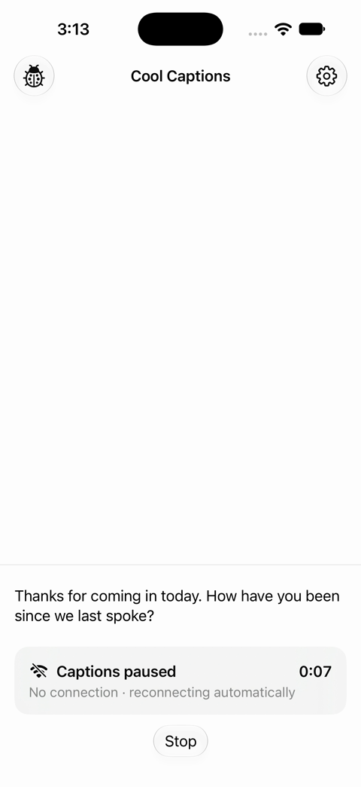
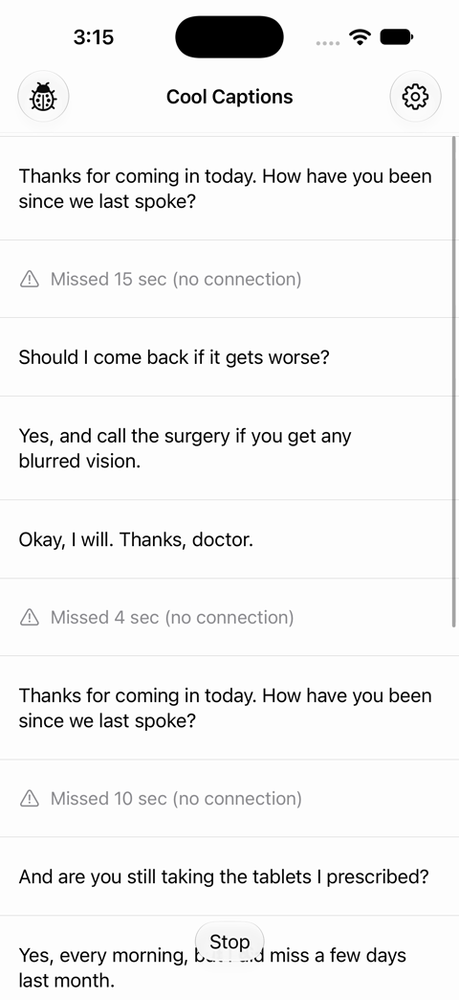
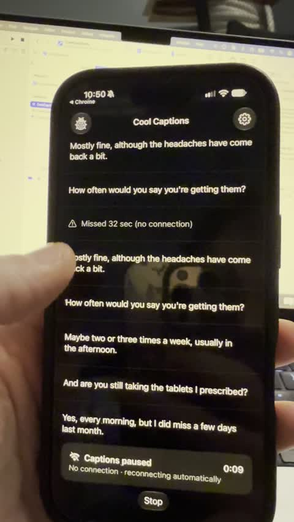

# How the change was built

This is the companion to [REPORT.md](../REPORT.md). The report covers why the change was made. This document covers how it works, how it was tested, and the decisions made along the way.

The branch is `Add-Disconnected-UI`. Compared with `main`, it adds 490 lines of app code and 738 lines of tests. Another 117 lines in the project file set up the UI test target.

## 1. What changed, file by file

Every new piece copies a pattern the sample already had: a service class like `Connection`, a screen model and view pair like `DebugScreen` and `DebugScreenView`, and a toolbar button and sheet like the Debug button.

**New**

| File | What it does |
|---|---|
| `Models/Gap.swift` | One stretch of time when captions were paused: when it started, how long it lasted, and whether the user was shown an alert for it. |
| `Models/DisplayItem.swift` | A transcript row, either a caption or a finished gap. |
| `Screens/TranscriptView.swift` | The scrolling transcript, moved out of `CaptioningScreenView` so it only redraws when its rows change. |
| `Screens/PausedStatusView.swift` | The "Captions paused" card and its timer. |
| `Screens/GapMarkerView.swift` | The "Missed 1 min, 12 sec (no connection)" row. |
| `Screens/SettingsScreen.swift`, `SettingsScreenView.swift` | The settings sheet with the two switches. |
| `Services/FeatureFlags.swift` | The team's switches: `dropAlerts` and `gapMarkers`. |
| `Services/Preferences.swift` | The user's switches: `vibratesWhenPaused` and `announcesWithVoiceOver`. |
| `Services/Platform.swift` | What the screen needs from the device: the clocks, the locale and the announcer. Tests replace these. |
| `Services/VoiceOver.swift` | Posts a high-priority VoiceOver announcement. |

**Changed**

| File | Change |
|---|---|
| `Screens/CaptioningScreen.swift` | The gap logic, what to show, when to buzz and announce, and the wording. |
| `Screens/CaptioningScreenView.swift` | Shows the transcript, the paused card above Stop, and plays the buzz. |
| `Services/Connection.swift` | A `statusDidChange` hook, so the screen sees every change. |
| `Services/Captioner.swift` | An injectable `wait`, and a fix for captions arriving after Stop. |
| `Services/Analytics.swift` | Ten new events. |
| `CoolCaptions.swift`, `CoolCaptionsView.swift` | Create the new services, add the gear button and the settings sheet. |
| `Screens/DebugScreen.swift`, `DebugScreenView.swift` | A "Feature flags" section with the two flags. |

## 2. The state model

The core rule is a single sentence: **captions are paused while captioning is running and the connection is disconnected.**

```swift
var isPaused: Bool {
    captioner.isRunning && connection.status == .disconnected
}
```

`isPaused` is worked out from the two sources of truth every time, not stored, so it can never drift from them. Degraded doesn't count. Captions still arrive during lag, just later.

### Gaps record when that was true

This excerpt is from `Models/Gap.swift`, with the comments shortened:

```swift
struct Gap: Identifiable, Equatable {
    let id: UUID
    let start: Date                         // wall clock: ordering and the on-screen timer
    let startInstant: ContinuousClock.Instant
    var duration: Duration?                 // nil while the gap is still open
    var showsAlert: Bool                    // fixed when the gap opens
    var isOpen: Bool { duration == nil }
}
```

- **Two clocks.** `start` is wall-clock time, because captions carry wall-clock dates and the transcript has to place the gap between them. `duration` is measured on a monotonic clock, because the wall clock can jump while a phone is offline (a time sync, or a change of time zone). A test moves the wall clock back an hour in the middle of a drop and checks that "Missed…" is unchanged.
- **`showsAlert` is fixed when a gap opens.** If the flag turns on in the middle of an outage, the alert waits for the next drop. Otherwise, analytics would count an alert the user never saw.

### One function opens and closes gaps

`recordGap()` in `CaptioningScreen` runs after every status change and every Start or Stop. It compares "paused now" with "is a gap open?":

- **Paused, and no gap is open:** open one. If Stop closed the last gap while the same outage is still going, reopen that gap instead. Then buzz (only for a new gap), log `captionGapStarted`, and announce.
- **Not paused, but a gap is open:** close it, log `captionGapEnded`, and announce how much was missed. Stop also closes the gap but announces nothing, because captions didn't come back.

### The transcript is a merge, not a sort

```swift
var items: [DisplayItem] {
    var items: [DisplayItem] = []
    let showsMarkers = flags.dropAlerts && flags.gapMarkers
    var gaps = showsMarkers ? gaps.filter { $0.showsAlert && !$0.isOpen }[...] : []

    for caption in captions {
        while let gap = gaps.first, gap.start < caption.date {
            items.append(.gap(gap))
            gaps.removeFirst()
        }
        items.append(.caption(caption))
    }
    return items + gaps.map(DisplayItem.gap)
}
```

- Captions keep their original order, and a caption wins a tie with a gap that starts in the same second. Same-second timestamps are common in the data.
- An open gap stays out of the transcript. The paused card already shows it, and a marker that appeared and then changed would make the transcript jump.

### What the view reads

- `showsPausedStatus` and `pausedSince`: the card shows only while the open gap has an alert. Its timer counts from the gap's start, so Stop and Start during a drop don't reset it.
- `hapticTrigger`: a counter that goes up by one for each buzz. The view plays `.sensoryFeedback(.warning, trigger: model.hapticTrigger)`. The model decides when to buzz, so "no buzz when Vibrate is off" is something a test can check.

## 3. The rules the tests lock in

- A gap opens when "captioning and disconnected" becomes true, and closes when it stops being true.
- Degraded never opens a gap.
- **One outage gives one gap,** however many times the user stops and starts during it. Users who notice a drop restart a median of 3 times, so this case is common. If the connection comes back while captioning is stopped, that outage is over, and the next drop opens a new gap.
- A repeated status event changes nothing. The data contains some.
- There's no minimum length. The shortest drop in the data is 3 s, and the wording tells the user how big the gap was.
- **One buzz per outage.** Pressing Start again during the same outage brings the card back and announces it again, but doesn't buzz, because the user is already looking at the screen.
- The user can turn off the buzz and the announcements, but not the card or the marker.
- **Flags and settings only change what the user sees and feels.** Gaps are recorded and logged the same way whatever they say, so both test groups are measured identically.
- `gapMarkers` only has an effect while `dropAlerts` is on.

## 4. How status changes reach the screen

The first version passed status changes in from the view with `.onChange(of: connection.status)`. A review found a hole in that: two changes in one main-actor turn, such as a drop and an immediate recovery, are merged before the next render, so `.onChange` sees "healthy to healthy" and the drop is lost.

The fix is a synchronous hook on `Connection`:

```swift
var status: Status = .healthy {
    didSet {
        statusChanged()
        statusDidChange?()
    }
}

/// shortcut: one listener, the captioning screen. Use a list if a second screen needs it.
@ObservationIgnored var statusDidChange: (@MainActor () -> Void)?
```

`CaptioningScreen` sets it in its `init` with `[weak self]`. A test (`dropAndRecoveryBeforeTheNextRenderAreStillRecorded`) makes both changes back to back and checks that a 2-second gap is recorded.

## 5. The cues

### Wording

- The text comes from Foundation's `Duration` unit formatting, so it's translated for every locale and the units are correct ("1 min, 12 sec", "1 hr").
- On screen the units are short: "Missed 1 min, 12 sec (no connection)". For VoiceOver they're spelled out ("Missed 1 minute, 12 seconds. No connection."), because "min" is read less clearly.
- All model text uses `String(localized:comment:)` with a note for translators.
- A parameterized test checks 3 s, 45 s, 72 s, 130 s and 1 h, with the locale fixed to en_US.

### Accessibility

- **The paused card is one VoiceOver element** labelled "Captions paused. No connection. Reconnecting automatically.". The timer is left out of the label, because VoiceOver would read it as a string of digits.
- **The marker is one element** with the spelled-out label, in its place in the transcript.
- **The announcements are high priority**, so they interrupt what VoiceOver is reading. Braille displays show them too.
- **Largest text size:** the card uses `ViewThatFits`. The title and timer sit side by side when they fit, and stack otherwise. At the largest size, the title first broke mid-word ("Cap-tions"), and then got cut off as "Captions…". Both were fixed and checked by eye. The settings sheet can grow to full height, because at the largest size its second switch was cut off.
- **Dark mode:** everything uses system materials and colours. It was checked in the simulator and on a real iPhone.
- **Reduce Motion:** nothing in the change animates. The card and the marker appear instantly.
- **Elements can be found by identifier** (`pausedStatus`, `gapMarker`, `connectionPicker`), which the UI tests use.

## 6. Settings and feature flags

**Settings** (`Preferences` and `SettingsScreen`) hold the user's two switches, both on by default. `SettingsScreen` writes each change through to `Preferences` and logs it, the same way `DebugScreen` writes through to `Connection`. The sheet's footer says "The screen always shows when captions pause.", so nobody expects the switches to hide the card.

**Flags** (`FeatureFlags`) are two switches on the Debug screen. "Gap markers" is greyed out while "Drop alerts" is off.

| Flag | Controls | Purpose |
|---|---|---|
| `dropAlerts` | The card, the buzz, the announcements, the marker and the gear button | Splits users into test groups, and turns all of it off |
| `gapMarkers` | The marker alone | An off switch for the one part that changes the transcript |

Why two flags rather than one or three:

- **Not three.** The test can only afford two groups. Three flags make 8 combinations, some meaningless, such as settings for an alert that never fires. The settings only adjust the alert, so they appear exactly when it can.
- **Not one.** The marker is the only part that changes the transcript, so it can fail on its own, with a wrong duration or the transcript jumping while someone has scrolled up. Its own switch keeps the live warning running while the marker is off.

In the sample, both flags start on so the app shows the change. Neither the flags nor the settings are saved between launches, since persistence isn't needed for the change.

## 7. Analytics

| Event | When | What it's for |
|---|---|---|
| `captionGapStarted`, `captionGapEnded` | Each paused stretch, in both groups | Measures drops the user experienced without rebuilding them from raw events. A restart during a drop logs a second started/ended pair, so count drops from `connectionStatusBecameDisconnected`. |
| `pausedStatusWasShown` | Each paused stretch while `dropAlerts` is on | Marks which drops showed an alert, so the groups can be told apart. |
| `settingsButtonWasPressed`, `settingsScreenAppeared`, `settingsScreenDisappeared` | Opening and closing the settings | How often people look at the settings. |
| `vibrationWasTurnedOn`/`Off`, `announcementsWereTurnedOn`/`Off` | Each switch change | A high turn-off rate means the cue lands at bad moments. |

## 8. Concurrency and reliability

- The app target defaults to main-actor isolation, and all the new state lives on the main actor. Nothing new runs in the background.
- **A real bug in the original code, fixed alongside:** `Captioner` checked for cancellation only *before* each wait. A `Task.sleep` that had already finished when Stop was pressed returned normally, and the loop could add one more caption after Stop. Each wait is now followed by `try Task.checkCancellation()`. `CaptionerTests` reproduces this deterministically with a wait that ignores cancellation. It may also explain some of the caption events in the data that arrive after Stop.
- **Test seams, kept small:**
  - `Captioner` takes a `wait` closure. Its default is `Task.sleep`, and the screen tests pass one that never ends, so the canned conversation can't add captions mid-test.
  - `CaptioningScreen` takes a `Platform` (the wall clock, the monotonic clock, the locale and the announcer). Its defaults are the real ones, so only tests build their own.
  - The test target has an `AnalyticsSpy` (a subclass that records events), an `AnnouncementSpy` and a `TestClock` you move forward by hand.
- The whole project builds with no warnings in Swift 6 language mode as well as the project's Swift 5 setting.

## 9. Testing

The change was built test-first, in eight cycles: test setup, the paused state, recording gaps, edge cases from the data, analytics, wording and cues, settings, and flags. The view wiring came last. For each test: write it, watch it fail, write the least code that passes, then tidy up.

**Unit tests (Swift Testing):** 44 tests, 52 cases once the parameterized ones are counted.

| Suite | Covers |
|---|---|
| `CaptioningScreenTests` (38) | The paused state, gap recording, transcript order, edge cases, analytics, wording, announcements, the buzz, settings and flags |
| `CaptionerTests` (1) | No caption after Stop, even when a wait finishes late |
| `SettingsScreenTests` (2) | Each switch writes through and logs, in both directions |
| `CoolCaptionsTests` (3) | The gear button, the flag hiding it, and the screens sharing one set of settings and flags |

One test, `aGapIsOpenExactlyWhilePaused`, replays a scripted mix of 17 toggles and status changes and checks the core rule after every step.

**UI tests (XCTest):** 3 tests that drive the real app through the Debug sheet: a drop then recovery, the gear opening the settings, and the flag hiding the card and the gear.

**Run them** with ⌘U in Xcode, or:

```bash
xcodebuild test -project CoolCaptions.xcodeproj -scheme CoolCaptions -destination 'platform=iOS Simulator,name=iPhone 18 Pro' -collect-test-diagnostics never
```

The suite passes with Xcode's default parallel testing. If tests fail in ways that don't match the code, use Product › Clean Build Folder first.

**Checked by hand**, in the simulator and on an iPhone:

| | |
|---|---|
|  |  |
| A drop: the card and its timer | Recovery: markers in place between captions |

- A drop, then recovery: a marker in place between captions.
- Stop and Start during one drop: one gap, and the timer kept counting.
- Each flag turned off and on during a session (see the recordings).
- The settings sheet, and the gear disappearing when "Drop alerts" is off.
- Dark mode, the largest text size, and Reduce Motion.
- VoiceOver's reading order, through the accessibility tree.

**Not yet verified:**
- The simulator can't run VoiceOver, so hearing the announcements and reading them on a braille display needs a real device with VoiceOver on. The buzz needs a hand on a real phone. Both are the first step of the release plan.
- A marker arriving while the user has scrolled up the transcript. This is the main risk the `gapMarkers` switch exists for.
- Turning each setting off in the middle of a drop. The unit tests cover each setting, but not this exact sequence.

## 10. Reviews

After the build, the branch went through three reviews, and every finding was either fixed or shown to be wrong:

1. **Concurrency review.** It found the Stop race, the lost drop-and-recovery, flaky tests from the real conversation, and gaps measured on the wall clock. One claim, that the old `Platform` wouldn't build in Swift 6 mode, was wrong: it built cleanly.
2. **SwiftUI review.** One container per transcript row, localized model text, the card's layout through `ViewThatFits`, `safeAreaBar` for the bottom bar, and each view in its own file. `PausedStatusView` (at default and largest text), `GapMarkerView` and `SettingsScreenView` have `#Preview`s.
3. **A cut pass before review.** It removed 11 unit tests that repeated others or only checked default values, and 1 slow UI test that repeated unit tests. It also removed a stored field (`Gap.end`) that was written but never read, and fixed one settings test that checked the wrong property.

## 11. Shortcuts and what production would need

- **Flags:** in memory only. A real flag service would assign users to groups, record each user's group, and default `dropAlerts` to off.
- **Settings:** reset at every launch. Production would save them.
- **Saved transcripts:** the sample has none, so markers live only on screen. For Tom's use, production needs markers in stored and shared transcripts.
- **`statusDidChange`:** has one listener. A second screen would need a list.
- **The missed speech itself isn't recovered.** That's the real long-term fix, and it needs audio buffering, which the ground rules exclude.

## 12. Splitting the branch into pull requests

As one pull request, this branch is about 1,350 lines. That's too much to review well, and the core gap logic would get the same attention as a corner radius. I'd split it into nine stacked PRs, each with one idea, its own tests, and nothing visible to users until the flag turns on.

**How each PR stays safe to merge:** everything after PR 3 sits behind `dropAlerts`, which defaults to off in production. Each PR can merge to `main` and ship without anyone seeing it. PR 1 is a bug fix that ships straight away.

| # | Pull request | What's in it | Size (app + tests) | What the reviewer should focus on |
|---|---|---|---|---|
| 1 | **Test doubles and the Stop fix** | `AnalyticsSpy`, `TestClock`, the injectable `wait` in `Captioner`, the cancellation check after each wait, and `CaptionerTests` | ~10 + ~65 | Is the race real, and does the test reproduce it deterministically? |
| 2 | **UI test target** | The `CoolCaptionsUITests` target, plus one launch test | ~120 project file + ~30 | Project-file changes only. The target was added by hand, so it's worth reviewing on its own. |
| 3 | **Feature flags** | `FeatureFlags`, the "Feature flags" section on the Debug screen, and the wiring in `CoolCaptions` | ~35 + ~10 | Flag names and defaults. Nothing reads the flags yet. |
| 4 | **Paused state and gap recording** | `isPaused`, `Connection.statusDidChange`, `Gap`, the clocks in `Platform`, `recordGap()` for single drops, and the `captionGapStarted` and `captionGapEnded` events | ~70 + ~150 | The core rule, and why it's a hook rather than `.onChange`. This is the most important review. |
| 5 | **One gap per outage** | `canReopenLastGap`: Stop and Start during one outage keep one gap | ~15 + ~105 | The edge cases, including an outage that ends while captioning is stopped. A small change with many tests. |
| 6 | **Paused status card** | `PausedStatusView`, `showsPausedStatus`, `pausedSince`, the bottom bar, and `pausedStatusWasShown` | ~80 + ~85 | Layout at the largest text size, the VoiceOver label, and the timer surviving a restart. Screenshots in the PR. |
| 7 | **Transcript marker** | `DisplayItem`, `TranscriptView`, `GapMarkerView`, `items`, the wording, and the `gapMarkers` switch | ~110 + ~70 | Ordering when a caption and a gap share a second, the localized wording, and open gaps staying out of the transcript. |
| 8 | **Buzz and announcements** | `hapticTrigger`, `VoiceOver.swift`, `announce` in `Platform`, and `AnnouncementSpy` | ~40 + ~70 | One buzz per outage, no resume announcement after Stop, and no cue for lag. |
| 9 | **Settings sheet** | `Preferences`, `SettingsScreen` and its view, the gear button, and the settings events | ~130 + ~100 | The defaults (both on, and why), and that the card and marker ignore the settings. |

### Order

```
1 ─▶ 3 ─▶ 4 ─▶ 5 ─▶ 6 ─▶ 7 ─▶ 8 ─▶ 9
2 ────────────────▶ (before 6, which adds the first real UI test)
```

- PRs 6, 7 and 8 only need PR 5, so they could be reviewed in parallel. But all three change `CaptioningScreen` and its view, so I'd stack them in this order to avoid merge conflicts.
- PR 9 needs PR 8, because the settings switch the buzz and the announcements.
- **PR 4 is worth shipping early on its own.** It changes nothing on screen, but it starts logging gap events for everyone. That gives the experiment a clean baseline from the new events before any user sees the change.

### Each PR's description

- the one rule or behaviour it adds, in a sentence
- the tests that pin it down, and which ones failed first
- how to try it: which Debug sheet settings to use
- screenshots or a short recording for PRs 6–9

### Getting there from this branch

The branch's commits already follow roughly this order, because it was built in cycles. But the fixes from the reviews and the cut pass landed at the end and touch most files. Splitting means rebasing each fix into the PR it belongs to. For example, the `statusDidChange` hook goes into PR 4, and the `ViewThatFits` layout goes into PR 6. That's an hour or two of careful history editing, with the test suite run at every step.

### Tickets outside these PRs

These aren't code in this branch, but they need tracking:

| Ticket | Why | Blocks |
|---|---|---|
| Connect `FeatureFlags` to the real flag service, with `dropAlerts` off by default and each user's group recorded | The experiment can't run without it | The 50/50 test |
| Real-device check: VoiceOver announcements, a braille display, the buzz, and poor Wi-Fi | The simulator can't check any of these | The 50/50 test |
| Experiment dashboard: restarts per drop, mid-drop exits, cue turn-off rates, guardrails, and retention after drops of 30 s or more | So the 4-week decision is a read-out, not an analysis project | The rollout decision |
| Investigate captions that arrive after Stop in production data | Possibly a privacy issue (see the report's caveats) | Nothing. Separate priority. |
| Follow-ups, if the experiment works: watch haptics, markers in saved and shared transcripts, saving the settings, and recovering the missed speech | Out of scope for this change | Nothing |

## Recordings

In [`recordings/`](recordings/):

- [**01-drop-and-marker.mp4**](recordings/01-drop-and-marker.mp4) (simulator, 28 s): a drop, the card and its timer, then a "Missed 15 sec" marker between captions.
- [**02-alerts-off.mp4**](recordings/02-alerts-off.mp4) (simulator, 31 s): with "Drop alerts" off, the gear is gone, and a drop shows nothing. This is the control group, and today's app.
- [**03-markers-switch.mp4**](recordings/03-markers-switch.mp4) (simulator, 19 s): "Gap markers" off hides only the markers. Turned back on, they reappear in place.
- [**04-iphone-dark-mode.mov**](recordings/04-iphone-dark-mode.mov) (real iPhone, 34 s): a transcript with an earlier "Missed 32 sec" marker, then a new drop with the card counting, then recovery from the Debug sheet.


