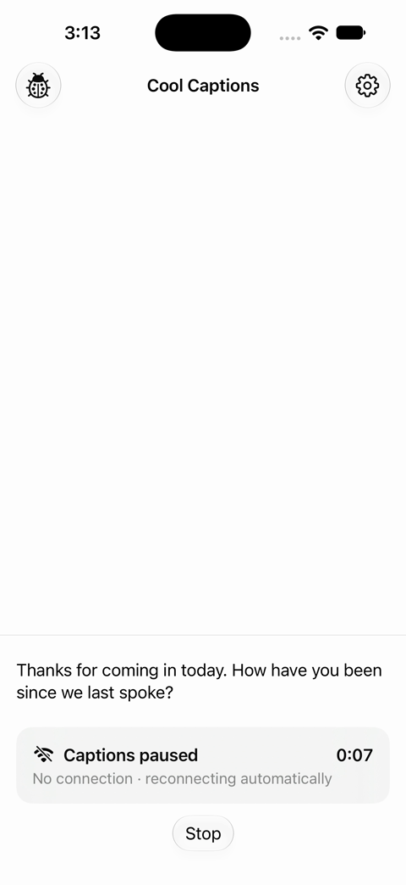
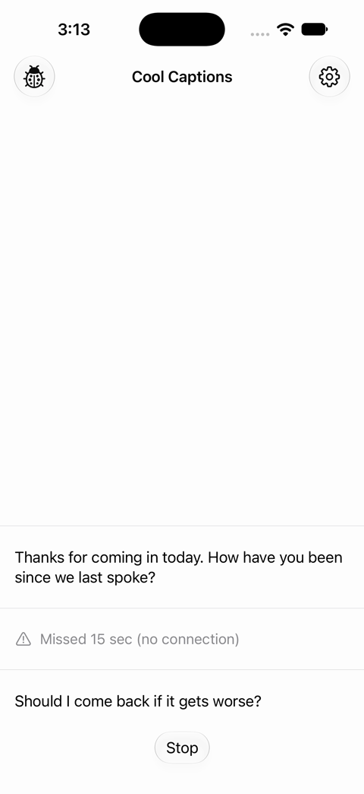
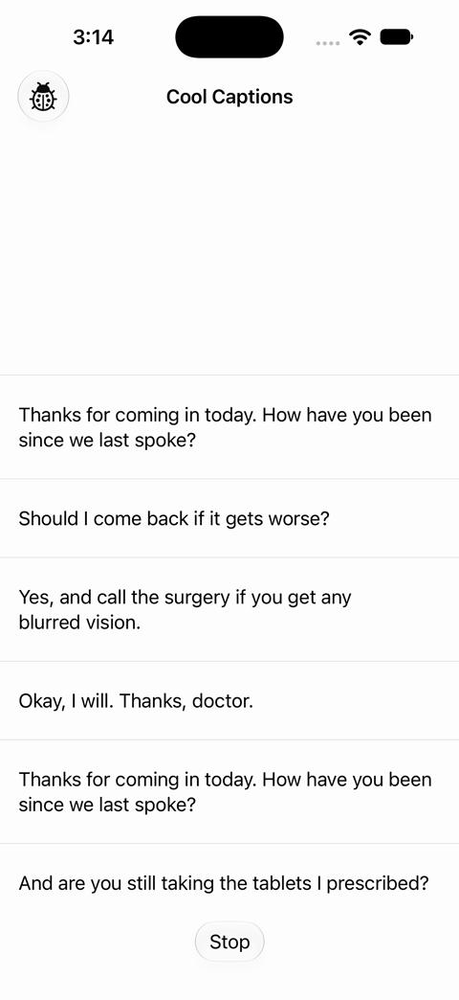

# Cool Captions: making connection drops visible

**In short:** Lag doesn't hurt anyone. Connection drops do, and they hurt most the people who never notice them. After a launch with an unnoticed drop of 30 seconds or more, 38.5% of users never opened the app again, against 3.3% after a launch with no drop. The change makes every drop visible while it happens, and leaves an honest record of it in the transcript.

How it was built, tested and split into pull requests is in [Docs/IMPLEMENTATION.md](Docs/IMPLEMENTATION.md).

## 1. The problem

The team's hunch is that users don't *understand* connection changes. The data narrows that down:

1. **It's drops, not lag.** Lag is about four times as common, but it loses almost nothing and almost nobody reacts to it.
2. **It's awareness, not understanding.** The users who lose trust never knew anything had happened. When captions stop, the last line stays on screen, which looks the same as the speaker pausing. Tom ("I thought she'd just paused"), Ellie ("I thought he'd just stopped talking") and Priya ("quiet could mean anything") all describe that moment.

The code agrees: `Captioner` logs every caption it misses, but the captioning screen couldn't see `Connection`, so nothing on screen changed.

## 2. Evidence

I replayed `Data/events.csv` for each user: 642,642 events from 420 users, 5 January to 29 March 2026.

- A **drop** runs from `connectionStatusBecameDisconnected` to the next status change, or until the app goes to the background.
- A user **reacts** when they first press Stop during a drop. A **restart** is Stop, then Start within 10 s.
- A **last-ever** launch is one the user never followed with another. Only launches at least 14 days before the data ends count.

| | Degraded (lag) | Disconnected |
|---|---|---|
| Episodes (users) | 917 (295) | 238 (165) |
| Median length | ~3 min | 71 s |
| Captions lost | 1 | 676 |
| Episodes with a stop and restart | 0.5% | 37% |

The lag figures match Marta: "I've learned not to worry about that." Drops split users into two groups:

- **People who notice, like Priya.** They react a median 16 s into the drop (90% within 23 s), close to her "ten seconds where I'm guessing". Then they restart a median of 3 times. That never helps: the connection comes back on its own, a median 27 s after the last restart. 19% of drops end with the user leaving the app, but they come back, typically within about 2 days.
- **People who don't notice, like Tom and Ellie.** 62% of drops get no reaction at all, and this is where trust breaks:

| What happened in that launch | Launches | Was the user's last-ever launch |
|---|---|---|
| No drop | 3,825 | 3.3% |
| Drop under 30 s, no reaction | 28 | 3.6% |
| **Drop of 30 s or more, no reaction** | **91** | **38.5%** |
| Drop, user restarted | 33 | 6.1% |
| Drop, user gave up mid-drop | 42 | 0% |

- The sample is small but the difference is clear. The 95% interval for 38.5% is about 29–49%, against 2.7–3.9% with no drop. It holds with cutoffs from 7 to 28 days, and for new and long-time users. The smaller groups are directional only.
- 36 of the 164 users who stopped using the app had an unnoticed drop in their final launch. Only about 3% of all launches have one.
- The groups are mostly different people. 72 users ever restarted, 56 had an unnoticed drop of 60 s or more, and only 10 are in both.

**It isn't getting worse.** Drops stay at 0.3–0.5 per 1,000 captions every week, while weekly active users grew from 124 to about 230. The rise in support messages most likely comes from having more users, though I don't have the ticket data to confirm it.

**Caveats:**
- The 38.5% is a correlation. People who miss a drop may be less engaged to begin with, and the experiment settles that.
- The brief says 500 users, but the data has 420.
- 1,685 captions (0.3%) arrive outside a started session. That may be logging noise, but captions after Stop would be a privacy issue worth its own ticket. The sample had one bug that could cause this, and it's now fixed.

## 3. The change

| While a drop is happening | After it ends | Control group (flag off) |
|---|---|---|
|  |  |  |

Recordings: [a drop and its marker](Docs/recordings/01-drop-and-marker.mp4), [the control group](Docs/recordings/02-alerts-off.mp4), [the marker switch](Docs/recordings/03-markers-switch.mp4), and [a real iPhone in dark mode](Docs/recordings/04-iphone-dark-mode.mov).

**While captioning is disconnected:**
- A card above Stop says "Captions paused", with "No connection · reconnecting automatically" and a timer counting from the drop. It answers Priya's "whether it's me or it", and makes restarting pointless.
- One warning buzz, for someone who is watching the speaker. Ellie: "I should be watching him."
- A high-priority VoiceOver announcement, for deafblind users on braille displays and some low-vision users.

**When the connection comes back:**
- A marker where the loss happened: "Missed 1 min, 12 sec (no connection)". Ellie learns whether to ask ("If it's two minutes I need to know that"), and Tom gets an honest record instead of a silent jump.
- The announcement "Captions resumed. Missed 1 minute, 12 seconds."

**A settings sheet** behind a gear button has two switches, Vibrate and Announce with VoiceOver. Both are on by default, because an alert people had to turn on would never reach the people who don't notice drops. The card and the marker can't be turned off.

**Decisions worth calling out:**
- **The alert starts with the drop.** Short drops don't hurt retention, but nobody can tell how long a drop will last, and waiting would bring back Priya's guessing.
- **One outage gives one gap,** one timer and one buzz, however many times the user restarts.
- **A known limit:** a buzz is easy to miss with the phone flat on a desk, as Tom and Ellie use it. The card and the marker still catch their next glance. Watch haptics would be a cheap follow-up.

I checked it on a real iPhone in dark mode, and in the simulator at the largest text size and through VoiceOver's reading order. 44 unit tests and 3 UI tests cover it.

**What I'm not doing:**
- **A lag indicator:** lag is harmless, and flagging it would teach people to ignore the alert that matters.
- **A mic waveform (Dev):** it shows the mic works, not that captions arrive, so it would falsely reassure during a drop.
- **Recovering the missed speech:** the real long-term fix, but it needs audio buffering and persistence. Next, if this works.
- **Auto-restart, or disabling Stop:** taking control away is worse. "Reconnecting automatically" covers it.
- **A sound for everyone:** most users wouldn't hear it, and it would interrupt the conversation.
- **Text size, dark mode, sharing, mic-permission timing (Marta, Dev):** real, but not why the app "just stopped".
- **Markers in saved transcripts, and the background:** the sample has no persistence, and every session in the data stopped before the app was backgrounded.

## 4. How I'd know it worked

**Release.** `dropAlerts` decides who gets the change, and `gapMarkers` turns off the marker on its own. In production, `dropAlerts` defaults to off.

1. **Real-device check, about 1 week**, on poor Wi-Fi: the VoiceOver announcements, a braille display, and the buzz.
2. **50/50 test, 4 weeks.** There are about 20 drops a week, so roughly 40 per group, enough for the early signals and guardrails.
3. **Roll out to everyone if those pass.** Proving the retention effect would take about 12 weeks at 50/50, even if the change cut the 22% who never come back to 8%. Holding a safety cue back from half of the users for a quarter is hard to justify, since Tom uses the app at medical appointments. So I'd ship, and track retention against this quarter's baseline, backed by interviews. A small holdout is the option if the team needs causal proof.

**What to measure.** Gap events are logged the same way in both groups, and `pausedStatusWasShown` marks each drop where the alert appeared.

| Measure | Today | Hoping for |
|---|---|---|
| **Main outcome:** launches with a drop of 30 s or more that weren't the user's last | 77.7% (17 such launches a week) | Closer to the 96.7% with no drop |
| Drops followed by a stop and restart | 37% | Much lower |
| Drops where the user leaves the app mid-drop | 19% | Not higher |
| Users who turn off Vibrate or announcements | n/a | Low |

The events can't show whether someone *noticed* a drop, so fewer restarts is the proxy, backed by interviews in both groups. Guardrails: restarts while healthy, session length, captions per session, crash-free sessions, and support messages about the app stopping.

**Roll back if any of these trip.** With about 40 drops per group, these are tripwires, not significance tests:
- Any gap event without a matching disconnect. A false alert teaches people the alert lies.
- Crash-free sessions more than 0.5 points below control.
- Restarts or mid-drop exits more than 10 points above control.
- Repeated complaints about the buzz or the announcements.

Use `gapMarkers` for marker-only problems, such as wrong durations or the transcript jumping while scrolled up. Use `dropAlerts` for anything else. A high turn-off rate for the cues means fixing them, for example with a gentler buzz, not rolling back.
